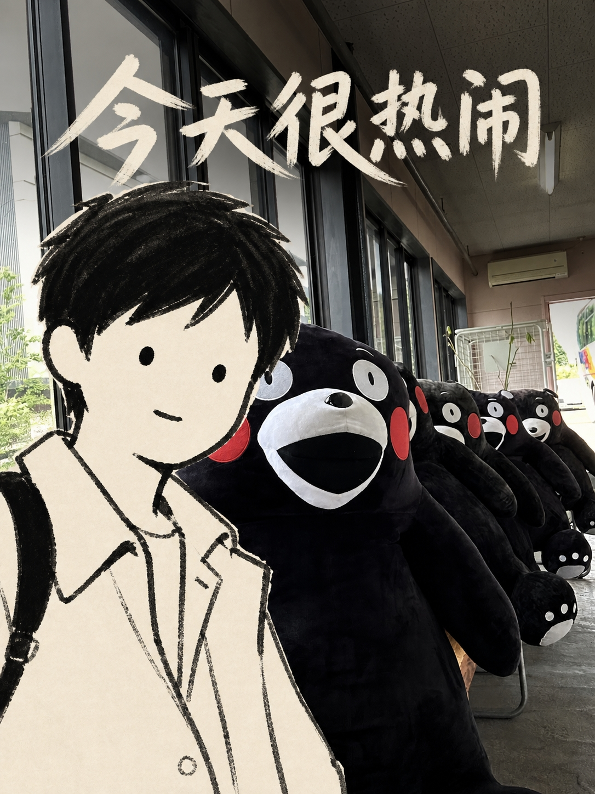
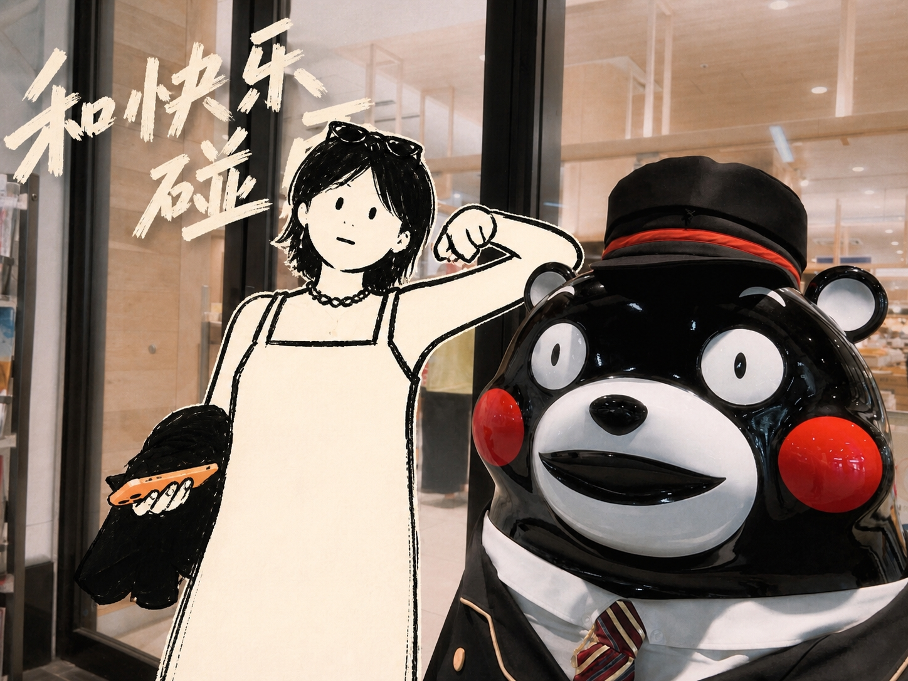
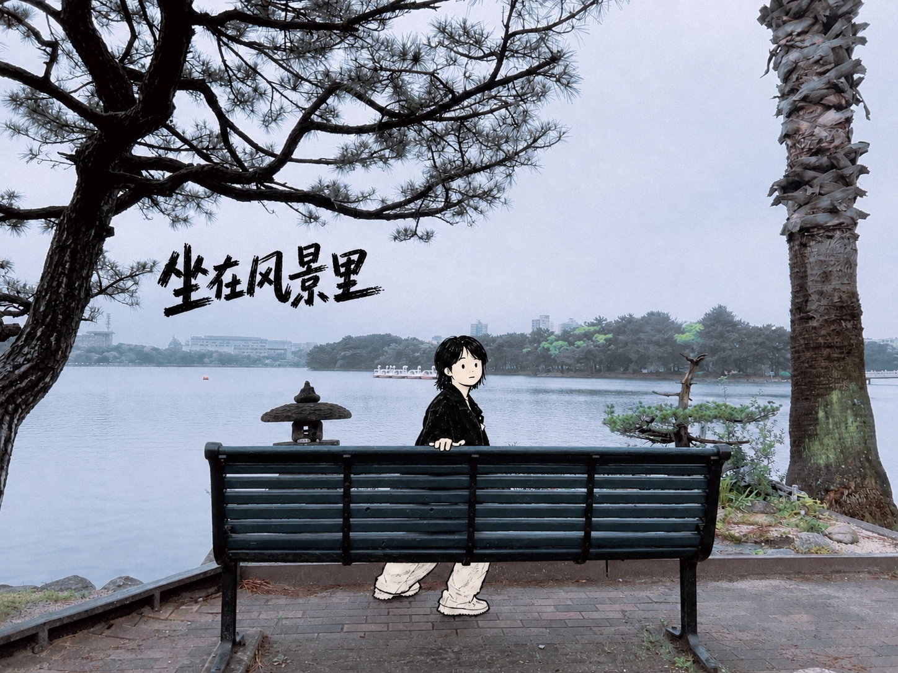
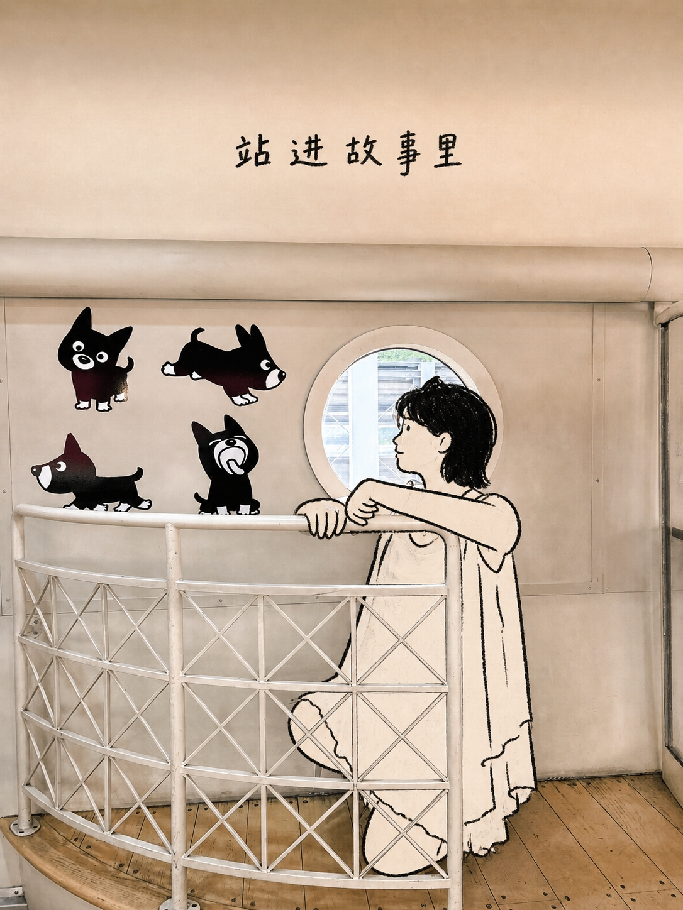

<div align="center">

# Photo Ink Character · 实景可爱简笔人物

**English** | [中文](README.zh-CN.md)

**Keep the real photo background, lighting, and occlusion — turn only the people into cute warm-paper black-ink characters.**

[](LICENSE.txt)
[](#-installation)
[](https://github.com/buttonsprite)

</div>

---

## Showcase

All real backgrounds, lighting, colors, props, and foreground occlusions stay untouched — only the chosen person is translated into warm-paper black-ink illustration.

<table>
  <tr>
    <td align="center" width="50%">
      <br/>
      <sub><b>Travel Selfie</b> — Real plushies & hallway preserved, adult proportions kept</sub>
    </td>
    <td align="center" width="50%">
      <br/>
      <sub><b>Single Color Accent</b> — Only the original orange phone stays in color</sub>
    </td>
  </tr>
  <tr>
    <td align="center" width="50%">
      <br/>
      <sub><b>Foreground Occlusion</b> — Lakeside bench cleanly occludes torso & legs</sub>
    </td>
    <td align="center" width="50%">
      <br/>
      <sub><b>Complex Occlusion</b> — Arms rest on top while lattice overlaps dress</sub>
    </td>
  </tr>
</table>

> *Note: By default this skill outputs **no text**. The handwritten titles in the showcase images above were added optionally using `references/optional-typography.md`.*

---

## Why I Built This

We all have photos where the scenery, light, and atmosphere are great — only the person's expression or pose feels awkward, so the photo sits in the camera roll forever.

Instead of applying a global cartoon filter that ruins the real photography, **`photo-ink-character`** performs strict local object editing:

- **100% Real Background**: Preserves lighting, color, depth, bystanders/props, and foreground occlusions (railings, benches, tables).
- **Warm-Paper Ink Character**: Translates only the specified person(s) into warm off-white paper fill with rough black crayon outlines, solid black hair/dark clothes, two dot eyes, and a short friendly mouth.
- **No Chibi Distortion**: Keeps the original adult head-to-body ratio, posture, hairstyle silhouette, and clothing volume. Cleans up stray flyaways gently without inventing a new person.
- **One Optional Color Accent**: Optionally keeps a single small colored item from the original photo (e.g., an orange phone, hat, or bag) as a visual pop.
- **Clean by Default**: No forced text, frames, stickers, or watermarks.

---

## Installation

Copy this repository into your agent's skills directory:

### Codex
```bash
git clone https://github.com/buttonsprite/photo-ink-character.git ~/.codex/skills/photo-ink-character
```

### Claude Code / Antigravity / General Agent Skills
```bash
# Claude Code (personal skills)
git clone https://github.com/buttonsprite/photo-ink-character.git ~/.claude/skills/photo-ink-character

# Antigravity
git clone https://github.com/buttonsprite/photo-ink-character.git ~/.gemini/config/skills/photo-ink-character
```

---

## How to Use

Attach your photo in your AI agent (with image-editing capability) and invoke the skill with natural prompts:

- `"Use photo-ink-character to turn me in this photo into an ink character. Keep the real background, no text."`
- `"Only transform the person on the right; keep her posture, hat, and phone."`
- `"Turn both people in this group photo into ink characters, leave all passersby and props untouched."`
- `"Keep the orange phone as the only color accent; everything else on the character stays black ink and warm paper."`
- `"Generate the clean no-text version first. Once I approve, add a short handwritten caption."`

---

## Great For vs. Not For

| Great For | Not Designed For |
| :--- | :--- |
| Daily selfies & half-body portraits | Turning the entire photo into an illustration |
| Travel & street photography | Replacing or regenerating the background |
| Group photos (transform all or selected people) | Photorealistic face likeness / portrait tracing |
| Back-view or side-profile shots | Chibi / big-head / exaggerated cartoon proportions |
| Photos with occlusion (benches, railings, desks) | Poster-first complex typography layouts |
| "Almost great" camera roll rescues | |

---

## Repository Structure

```text
photo-ink-character/
├── SKILL.md                           # Main skill contract & workflow
├── agents/openai.yaml                 # Agent metadata
├── references/
│   ├── figure-contract.md             # Identity anchors & B/W mapping rules
│   ├── background-contract.md         # Strict local-edit & occlusion rules
│   ├── qa-matrix.md                   # Visual acceptance & rejection criteria
│   └── optional-typography.md         # Opt-in handwritten caption rules
└── assets/accepted/                   # Accepted showcase outputs
```

---

## Part of the 100 Professions Challenge

This project is **Profession #03: Photo Ink Illustrator** in [**Buttonsprite (按钮精)**](https://github.com/buttonsprite)'s challenge: *exploring 100 professions with AI agents — one real project at a time*.

- **#01 Visual Art Director**: [visual-direction-moodboard](https://github.com/buttonsprite/visual-direction-moodboard)
- **#02 Travel Planner**: [interactive-trip-planner](https://github.com/buttonsprite/interactive-trip-planner)
- **#03 Photo Ink Illustrator**: `photo-ink-character` (you are here)

If this rescued a photo in your camera roll, consider giving it a ⭐ on GitHub!

## License

MIT © [Buttonsprite](https://github.com/buttonsprite)
