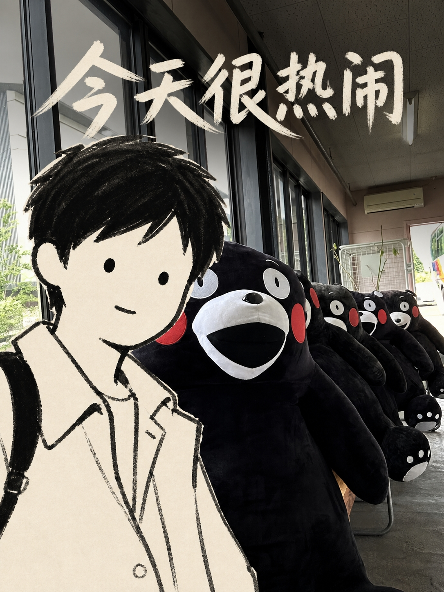
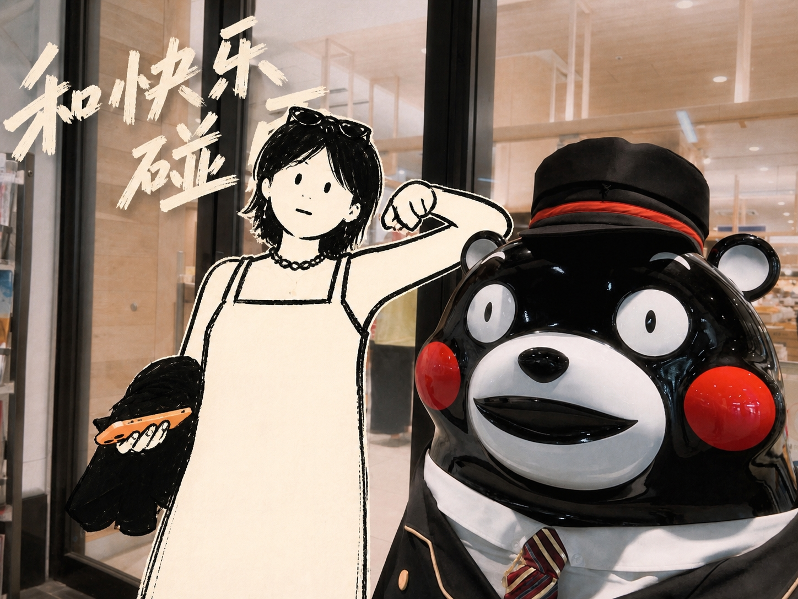
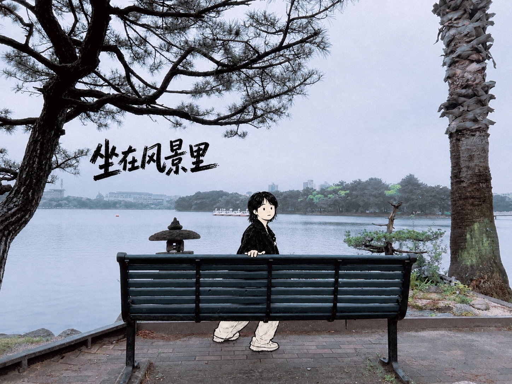
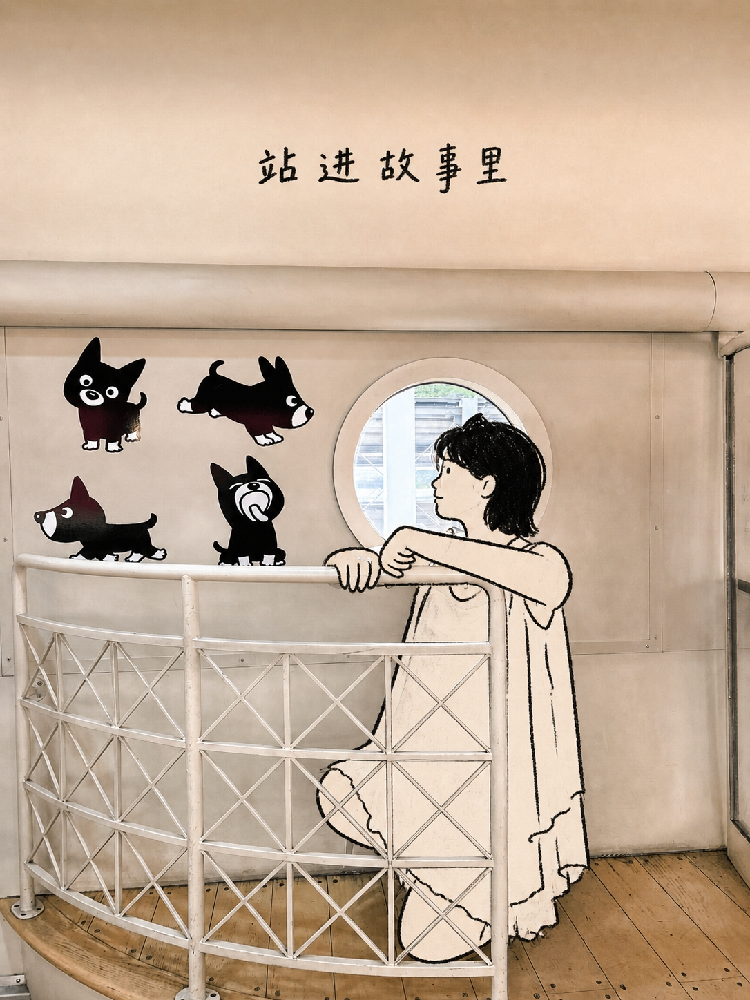

<div align="center">

# 实景可爱简笔人物 · Photo Ink Character

[English](README.md) | **中文**

**保留真实背景、光线与前后遮挡关系，只把照片里指定的人变成可爱的暖白纸张黑墨简笔角色。**

[](LICENSE.txt)
[](#-安装方式)
[](https://github.com/buttonsprite)

</div>

---

## 效果展示

真实照片的场景、光线、色彩、玩偶路人和前后遮挡关系全部原样保留，只将指定人物转换成黑墨纸片简笔风格。

<table>
  <tr>
    <td align="center" width="50%">
      <br/>
      <sub><b>旅行自拍</b> — 真实玩偶与背景完好保留，维持原本成人比例</sub>
    </td>
    <td align="center" width="50%">
      <br/>
      <sub><b>单色小配饰点缀</b> — 仅保留原图中的橙色手机作为点睛色</sub>
    </td>
  </tr>
  <tr>
    <td align="center" width="50%">
      <br/>
      <sub><b>前景遮挡保留</b> — 湖边长椅自然遮挡躯干，手脚关系准确</sub>
    </td>
    <td align="center" width="50%">
      <br/>
      <sub><b>复杂栅格遮挡</b> — 手臂搭在栏杆上方，网格清晰覆盖裙摆</sub>
    </td>
  </tr>
</table>

> *注：本 Skill 默认**不添加任何文字**。上方样图中的手写短句是通过可选规则 `references/optional-typography.md` 额外追加的效果。*

---

## 为什么做这个 Skill

有些照片的景色、光线和氛围都很好，只是人物状态不够理想，或者普通得让人不知道怎么发——删了可惜，发朋友圈又别扭。

与普通“整张图转漫画”的滤镜不同，**`photo-ink-character`** 坚持**严格局部对象编辑**：

- **真实照片背景 100% 不破坏**：保留原照片的构图、光线、颜色、路人/道具以及长椅、栏杆、桌面等前后遮挡关系。
- **暖白纸张 + 黑墨蜡笔轮廓**：只把你指定的人物变成极简可爱的黑墨纸片简笔角色，配两个小圆点眼睛与克制友好的短嘴。
- **不幼化、不大头**：严格沿用原人物的成人比例、姿态、发型轮廓与服装体积，仅对杂乱飞发和不自然五官做克制整理。
- **最多保留 1 个原图彩色小配饰**：如手机、帽子、包或鞋，作为全画面唯一的点睛色。
- **默认无多余装饰**：默认不加文字、无边框、无贴纸、无水印。

---

## 安装方式

将本仓库克隆到你的 Agent Skills 目录即可使用：

### Codex
```bash
git clone https://github.com/buttonsprite/photo-ink-character.git ~/.codex/skills/photo-ink-character
```

### Claude Code / Antigravity
```bash
# Claude Code
git clone https://github.com/buttonsprite/photo-ink-character.git ~/.claude/skills/photo-ink-character

# Antigravity
git clone https://github.com/buttonsprite/photo-ink-character.git ~/.gemini/config/skills/photo-ink-character
```

---

## 可以这样使用

在支持图像编辑的 AI Agent 中附上一张照片，直接用自然语言调用：

- “用 `photo-ink-character` 把照片里的我变成简笔人物，背景保持真实，不要加文字。”
- “只处理右边的人，保留她的姿势、帽子和手里的手机。”
- “把合照中的两个人都变成简笔人物，其他路人和玩偶不要改变。”
- “保留橙色手机作为唯一彩色点缀，其他人物区域使用黑色和暖白色。”
- “先生成无文字版本，通过后再增加一句手写标题。”

---

## 适用场景与边界

| 非常适合 | 不适合的需求 |
| :--- | :--- |
| 日常自拍与半身照 | 把整张照片都变成插画 |
| 旅行照和城市街景 | 完全替换或重新生成背景 |
| 多人合照（支持指定部分人） | 追求写实五官和精确人脸复刻 |
| 背影或侧脸照片 | 将人物改成大头、幼童或夸张卡通比例 |
| 被长椅、栏杆、桌面局部遮挡的照片 | 以复杂字体排版为主要结果 |
| 背景很好看、人物状态普通的“废片拯救” | |

---

## 仓库结构

```text
photo-ink-character/
├── SKILL.md                           # 核心 Skill 流程与硬性限制
├── agents/openai.yaml                 # Agent 元数据配置
├── references/
│   ├── figure-contract.md             # 人物识别锚点与黑白映射规则
│   ├── background-contract.md         # 严格局部编辑与遮挡保持规则
│   ├── qa-matrix.md                   # 成图视觉验收与淘汰标准
│   └── optional-typography.md         # 可选手写标题规则（仅按需触发）
└── assets/accepted/                   # 已验收的展示样图
```

---

## 「按钮精 · AI 探索 100 个职业」挑战

本项目是 [**按钮精 Buttonsprite**](https://github.com/buttonsprite) 的 **第 #03 站：实景简笔插画师**。

- **#01 视觉艺术指导**：[visual-direction-moodboard](https://github.com/buttonsprite/visual-direction-moodboard)
- **#02 定制旅行规划师**：[interactive-trip-planner](https://github.com/buttonsprite/interactive-trip-planner)
- **#03 实景简笔插画师**：`photo-ink-character`（当前项目）

如果这个工具帮你拯救了相册里的“废片”，欢迎点一个 ⭐ Star 支持一下！

## License

MIT © [Buttonsprite](https://github.com/buttonsprite)
